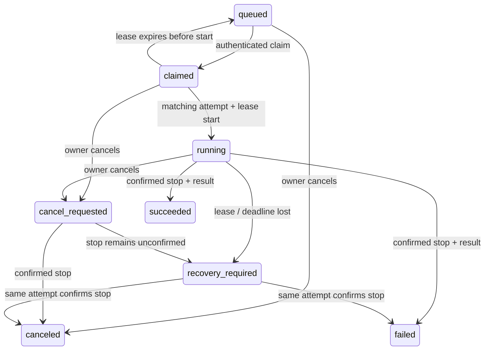

# Typed portable delegation protocol (development)

This is the NAS-side queue and the portable connector's transport library. It
is **not a native Agent executor or an A2A compatibility claim**. The current
CLI still only inventories/enrolls Agents; queued jobs do not automatically
start Codex, DSH or MiniMax Code. Native process supervision, protected execution
views, full snapshots, formal handoff and deployment acceptance remain unfinished.

## Request and output boundary

An authenticated user submits `schemaVersion: 1`, `kind: "prompt"`, an explicit
`agentId`, a caller-generated `idempotencyKey`, the prompt, optional text files,
and a timeout. The target must be one of that user's live, nonrevoked enrolled
identities. The provider comes from the identity registry, never a request's
command, binary path or executable arguments.

Limits are deliberate for this initial text contract:

- Prompt: 32 KiB. Timeout: 10–1800 seconds, default 300.
- Inputs: at most 64 UTF-8 files, 64 KiB each, 256 KiB in total.
- Results: 128 KiB text plus at most 64 UTF-8 files, 256 KiB each,
  512 KiB total file content.
- Relative portable paths only: no traversal, absolute/drive/UNC paths,
  Windows device names or alternate streams, case-fold collisions, or
  file-versus-directory prefix collisions. Directory normalization and actual
  filesystem restoration must still be verified by the future executor.

This is specified-input delegation, not full-workspace backup. It never scans
an existing local project or transfers its write ownership. Output files and
patch text are returned to the caller; nothing applies them to the original
working directory or publishes them to GitHub. Full snapshots will need a
separate streaming/storage contract and explicit model-readable views, without
reusing Git ignore rules as backup filters.

## Durable states and permissions

A recovery-required attempt may also report a completed success after confirmed
quiescence if cancellation was not committed. It cannot renew or resume work.
There is no automatic retry of started or unknown execution, nor an operator
"force success" endpoint. Recovery requires the same trusted attempt's stop
acknowledgement; manual recovery of an irretrievable/revoked worker remains to
be implemented before production release.

One Agent identity holds at most one active or recovery-required task. Other
Agent identities may execute independent delegates concurrently. Claiming only
returns inputs; **it is not execution permission**. A worker must obtain start
permission and maintain a live lease. This task lease is not the formal
handoff/workspace writer fence.

The worker generates and durably journals a fresh 256-bit lease proof **before**
claiming. A repeated claim with that proof reconciles an uncertain response.
Every subsequent operation requires the proof, task ID and monotonically
increasing attempt number. The NAS stores only the proof's hash; it never puts
proofs in URLs, state responses or audit events. Native worker journaling and
process supervision are requirements, not supplied by the transport library.

## Time, retries and cancellation

MySQL's `UTC_TIMESTAMP(3)` is the lease authority. Database clock errors fail
closed. The portable client subtracts the full RPC duration and a two-second
margin from `leaseRemainingMillis`, then creates a deadline on its local
monotonic clock. `TaskObservation.MayRun()` checks that deadline. Never compare
server lease timestamps to a workstation's wall clock, extend a deadline from
a stale response, or restore a serialized deadline as permission after restart.

The run timeout is absolute once start commits. Replaying start does not reset
it; renewals cannot extend it. Loss of a running lease creates
`recovery_required`, blocks the Agent's next task and sets `runAllowed: false`.
A late authenticated result can settle that same attempt only with confirmed
quiescence; this does not allow continuing after expiry.

Idempotency is scoped to user + exact, case-sensitive request key, indexed by
its hash to avoid database collation differences. Normalized identical input
returns the original task, even after the target identity is revoked; changed
input with the same key is rejected. Completion is likewise idempotent only
for identical normalized output and the same fenced attempt.

Cancellation commits either before or after completion. If completion won,
the owner sees its existing terminal state. If cancellation won, success cannot
overwrite it. Running/claimed cancellation stays `cancel_requested` until the
worker confirms stop; silence becomes `recovery_required`, never a fabricated
`canceled`. `quiesced: true` is an authenticated worker assertion that the
future process supervisor must substantiate, not a model-provided assertion or
independent hardware attestation.

## REST transport

| Route | Credential | Purpose |
| --- | --- | --- |
| `POST /api/connector-tasks` | Owner user | Submit typed request / reconcile key |
| `GET /api/connector-tasks` | Owner user | Latest 100 tasks, metadata only |
| `GET /api/connector-tasks/{id}` | Owner user | Inputs, status and committed result |
| `POST /api/connector-tasks/{id}/cancel` | Owner user | Request cancellation |
| `GET /api/connector-tasks/{id}/events?after=N` | Owner user | Up to 1000 subsequent audit events |
| `POST /runners/connector-tasks/claim` | Agent | Claim/reconcile using JSON `leaseToken` |
| `POST /runners/connector-tasks/{id}/start` | Agent + lease/attempt | Explicit start |
| `POST /runners/connector-tasks/{id}/renew` | Agent + lease/attempt | Renew / receive stop state |
| `POST /runners/connector-tasks/{id}/control` | Agent + lease/attempt | Observe without renewal |
| `POST /runners/connector-tasks/{id}/complete` | Agent + lease/attempt | Confirm quiescence and result |

Device credentials cannot call Agent operations, and Agent credentials cannot
call user management. Each task transaction rechecks parent revocation/expiry.
Handlers reject unknown Agent credentials before reading potentially large
payloads. Strict JSON decoding rejects unknown fields and trailing data.
Responses containing task data use `Cache-Control: no-store`; errors contain
no arbitrary remote diagnostics or input text.

State transitions and their audit events share a transaction. Duplicate claim,
start and completion acknowledgements do not add duplicate transitions; lease
renewals update the row without logging payloads. Events contain IDs, actor,
attempt, status and relevant lease/deadline times. Expiry events retain the
expired deadline and are recorded when expiry is observed. Prompts, output,
local paths and credentials are never audit fields.

The existing incremental schema registry knows the two new tables.
`migrations/034_connector_tasks.sql` provides reviewed additive manual DDL;
no task or account seeds are executed at service startup.

## Validation boundaries

Local tests cover portable paths and bounds, exact idempotency, fenced attempts,
parallel identities, lost claims, expiry without blind retry, cancellation,
transaction/audit rollback, owner isolation, payload authentication and SDK
wall-clock independence. All task content is synthetic; no real model is called.

An explicitly configured loopback-only MySQL fixture applies migrations 033/034
in a disposable schema, uses multiple connections, tests skewed caller clocks,
real claim/submission concurrency and stopped-attempt recovery. It is skipped
unless `LOOPFORGE_CONNECTOR_MYSQL_TEST_DSN` names `connector_fixture` on a literal
loopback address and `LOOPFORGE_CONNECTOR_MYSQL_TEST_ALLOW_CREATE=1` is set. It
never consumes `AGENTFLOW_MYSQL_DSN` or an ordinary production test DSN.

The fork's `portable-connectors` CI runs that fixture and native Windows
state-file/DACL tests. It does not install or run real Agent CLIs, publish an
image, change repository permissions, or deploy to the NAS. Native Agent
adapters, process-tree termination, crash journals, model-readable filesystem
boundaries, real browser/container acceptance and NAS deployment are separate
remaining gates.
